# Milestone 3: D3 Visualizations

**Team cyro (Team 3)**, CS-GY 6313 B Information Visualization, Fall 2026
Praneeth Yashovardhan Kadem (pk3206) · Bhavana Peruri (bp2847) · Likhith Vardhan Goruputi (lvg8030)

**Project:** Congestion Pricing in New York City: What Changed After the Toll?

> **The interactive version of this write-up is [`milestone3/index.html`](index.html)** (all eight D3 visualizations, with hover,
> toggles, brushing and linked views, and a "Show the D3 code" panel under each chart). This Markdown page has the same text with
> static screenshots so it can be read directly on GitHub.

## How to run the visualizations

The page loads CSV files with `fetch`, so it must be served over HTTP (opening the file directly with `file://` will not work).
D3 v7 is included in `milestone3/vendor/`, so no internet connection or install is needed.

```bash
git clone https://github.com/likhith2366/cyro.git
cd cyro                      # serve from the repository ROOT (the page reads ../data/processed/)
python -m http.server 8000
```

Then open **http://localhost:8000/milestone3/** in Chrome, Firefox, Edge or Safari.

If GitHub Pages is enabled for the repository (Settings → Pages → Deploy from branch `main`, folder `/ (root)`), the same page is
available at `https://likhith2366.github.io/cyro/milestone3/`.

## Files

| Path | What it is |
|---|---|
| `milestone3/index.html` | The write-up and all visualizations (one page, sections Q1–Q8) |
| `milestone3/js/common.js` | Shared helpers: colors, tooltip, legends, map drawing |
| `milestone3/js/q1.js` … `q8.js` | One D3 file per domain question |
| `milestone3/css/style.css` | Page and chart styles |
| `milestone3/data/nta2020.geojson`, `zone.geojson` | Map boundaries, built by `scripts/m3_build_geo.py` |
| `milestone3/vendor/d3.v7.min.js` | D3 v7.9 (local copy) |
| `data/processed/*.csv` | Input tables produced in Milestone 2 (unchanged) |
| `milestone3/screenshots/` | Static images used on this page |


## Introduction

On January 5, 2025 New York started charging most vehicles a toll to enter Manhattan at or below 60th Street, the **Congestion Relief Zone**. The peak toll for a car is \$9 (5 a.m.–9 p.m. on weekdays, 9 a.m.–9 p.m. on weekends) and lower overnight. Some roads inside the zone, mainly the FDR Drive and the West Side Highway, are not tolled.

Our project uses public MTA, NYPD, Citi Bike and NYC Planning data to let a reader look at the evidence directly: how many vehicles still enter the zone and when (Q1–Q3), whether traffic got faster and safer (Q4, Q5, Q7), where trips moved to (Q6), and which neighborhoods gained or paid (Q8). Because 2025 also brought return-to-office changes, weather and construction, we always compare the zone with the area just outside it and with the rest of the city, and we describe differences as associations, not proof that the toll caused them.

## What changed since Milestone 2

- **Q1:** the sketch's weekday/weekend toggle became a tolled / excluded-roadway toggle, because our processed table only covers weekdays; the 10-minute hover profile became an hourly profile panel (click a row).
- **Q4:** the speeds dataset has no peak/off-peak split, so the toggle now switches between mph and an index against the 2022–2024 average for the same month.
- **Q6:** the “from which neighborhoods” part now uses the MTA subway origin–destination estimates (Oct 2024 vs. Oct 2025), which we listed as a possible extension, so subway and Citi Bike are both trips *into* the zone in the same month. Citi Bike is shown for Oct 2024 vs. Oct 2025 (Pipeline B).
- **Q7:** the slope chart shows Jan–Sep totals for 2023–2026 indexed to 2024 instead of raw counts, since the rest of the city has ten times more crashes than the zone.
- Maps use the 2020 NTA boundaries (NYC Planning) and the same hand-digitized zone outline used in Milestone 2 (`scripts/m3_build_geo.py`).

## Q1. When and where do vehicles enter the zone on a typical weekday, and which entry points are the busiest?

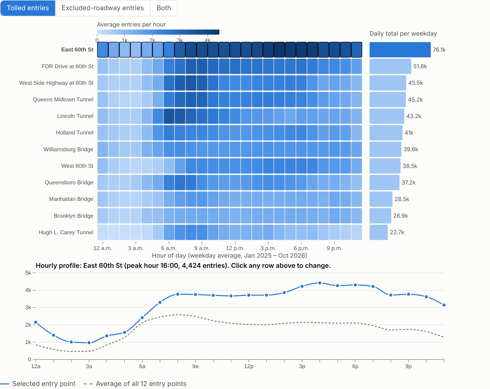

*Data: MTA Congestion Relief Zone Vehicle Entries, average over 452 non-holiday weekdays, Jan 5, 2025 – Oct 2026 (`q1_weekday_profile.csv`).*

**D3 code:** [`milestone3/js/q1.js`](js/q1.js) (uses helpers in [`js/common.js`](js/common.js))

**What the visualization shows**

The heatmap has one row per entry point (sorted by daily volume) and one column per hour; darker cells mean more vehicles. The bars on the right give each entry point's daily total, and the line chart below shows the hourly profile of the selected row against the average of all twelve.

On an average weekday about **496,000 tolled entries** are recorded. **East 60th St** is by far the busiest (about 76,000 a day, 15% of the total), followed by the FDR Drive, the West Side Highway, the Queens Midtown Tunnel and the Lincoln Tunnel (43–52,000 each). Traffic is lowest around **2 a.m.** (about 5,600 entries per hour across all points) and highest at **8 a.m.** (about 31,000). The tunnels from New Jersey and Brooklyn have a sharp morning peak, while East 60th St stays high from late morning into the evening.

Switching to **excluded-roadway entries** shows that untolled traffic is concentrated at only four points: the FDR Drive (≈29,500 a day), the Brooklyn Bridge (≈20,000), the Hugh L. Carey Tunnel (≈10,200) and the West Side Highway (≈5,300). These are vehicles that stay on the FDR or West Side Highway and never enter the tolled street grid, which leads into Q3.

## Q2. How has the number of entries changed since the toll started, and is the change different by vehicle class or for peak vs. overnight?

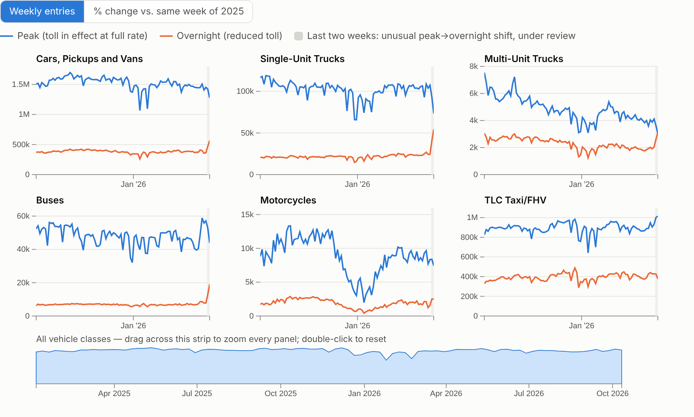

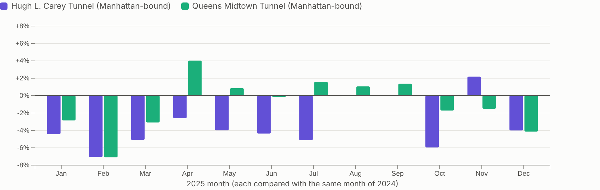

*Data: MTA CRZ Vehicle Entries, weekly sums by vehicle class and toll period, Jan 2025 – Oct 2026 (`q2_weekly_by_class.csv`). Each panel has its own y-axis because volumes differ by 100×.*

*Data: MTA Bridges and Tunnels Hourly Crossings, all vehicle classes, each 2025 month vs. the same month of 2024 (`q2_bt_yoy.csv`).*

**D3 code:** [`milestone3/js/q2.js`](js/q2.js) (uses helpers in [`js/common.js`](js/common.js))

**What the visualization shows**

The small multiples show weekly entries for each vehicle class, split into the **peak** period (blue) and **overnight** (orange). Dragging across the grey strip at the bottom zooms all six panels to the same date range, and the “% change” button compares each 2026 week with the same week of 2025.

Cars, pickups and vans make up 56% of all entries and taxis/for-hire vehicles 38%; both show dips around holidays. Comparing Jan–Sep 2026 with the same weeks of 2025, car entries were **8% lower at peak** and 7% lower overnight, while **taxis and for-hire vehicles stayed flat** (+0.1% peak, +5% overnight). Multi-unit trucks (−25%) and motorcycles (−33%) fell the most; single-unit trucks dropped at peak (−7%) but rose overnight (+7%), which is consistent with some deliveries moving to the cheaper overnight toll. So the decline continued into the toll's second year, mostly for private vehicles and trucks.

The grey band marks the last two weeks of data (Oct 4–17, 2026), where every class suddenly shifts from peak to overnight. We have not yet checked whether this is a change in how the source labels time periods, so those weeks are left out of the percentages above.

Because zone entries only start on toll day, the second chart provides the before/after view. Manhattan-bound crossings at the **Hugh L. Carey Tunnel were 3.4% lower in 2025** than in 2024 and at the **Queens Midtown Tunnel 0.9% lower**. The drop was largest in the first months (−7% in February at both tunnels) and smaller later in the year, so the change is real but modest at these two facilities.

## Q3. Are drivers avoiding the toll by using the FDR Drive and the West Side Highway instead?

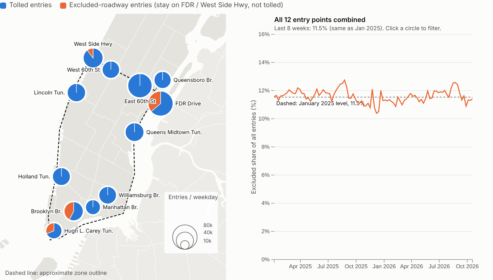

*Data: MTA CRZ Vehicle Entries, tolled vs. excluded-roadway entries (`q1_weekday_profile.csv`, `q3_excluded_share.csv`). Entry-point locations are approximate.*

**D3 code:** [`milestone3/js/q3.js`](js/q3.js) (uses helpers in [`js/common.js`](js/common.js))

**What the visualization shows**

Each circle on the map is an entry point; its size is the weekday volume and the orange slice is the share of vehicles that entered on an **excluded roadway** (they stay on the FDR Drive or West Side Highway and do not pay). Clicking a circle filters the line chart to that entry point; the dashed line marks its January 2025 level.

About **11.5% of all entries** are on excluded roadways. If drivers were increasingly detouring around the toll, this share would climb over time. It does not: it moves between about 11% and 12.4% with a seasonal bump each August, and in October 2026 it was 11.4%, almost the same as in January 2025. The excluded share is high at the Brooklyn Bridge (about 42%) and the FDR Drive (about 36%), but those shares are also stable.

**Limitation:** excluded-roadway counts start on toll day, so this view can show whether avoidance grew *after* the toll, but not how many drivers switched to the FDR or West Side Highway on day one compared with 2024.

## Q4. Has traffic inside the zone become faster compared with 2019–2024, and compared with the rest of the city?

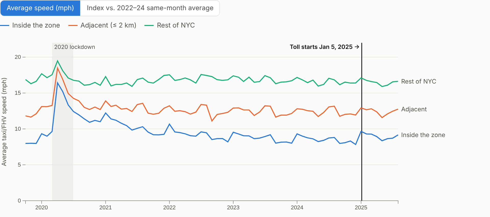

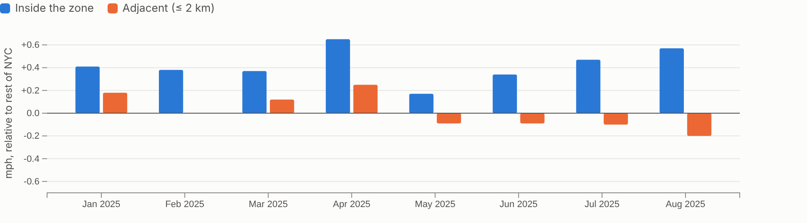

*Data: MTA CBD Taxi and FHV Speeds, monthly, Oct 2019 – Aug 2025 (`m2_q4_speeds_monthly.csv`). Speeds are computed from taxi and for-hire-vehicle trips, not all traffic.*

**D3 code:** [`milestone3/js/q4.js`](js/q4.js) (uses helpers in [`js/common.js`](js/common.js))

**What the visualization shows**

The top chart shows average taxi/FHV speeds inside the zone (blue), just outside it (orange) and in the rest of the city (aqua) since 2019. The grey band is the spring 2020 lockdown, when streets were empty, and the black line is the start of tolling. The index view divides each month by the 2022–2024 average for the same calendar month, which removes seasonality.

Inside-zone speeds fell steadily from about 12 mph in 2020 to **8.7 mph in 2024**. In 2025 that trend reversed: Jan–Aug 2025 averaged **9.0 mph (+0.27 mph, +3%)**, while the adjacent area (−0.14 mph) and the rest of NYC (−0.14 mph) got slightly slower. The bars below make the comparison explicit: inside the zone, the change from 2024 was 0.2–0.65 mph better than the rest of the city in **every month** of 2025, while the adjacent area hovers around zero. This is consistent with a real but modest speed-up in the tolled area that did not spill over to its neighbors.

## Q5. Did traffic or crashes get worse in neighborhoods just outside the zone?

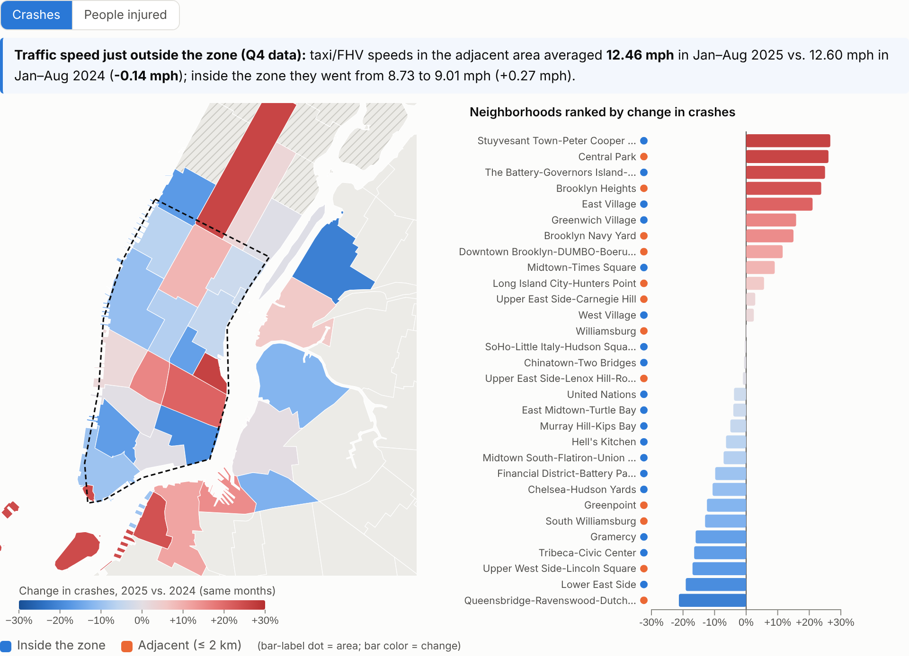

*Data: NYPD Motor Vehicle Collisions, 2025 vs. the same calendar months of 2024, per 2020 NTA (`q5_nta_crash_change.csv`); speeds from Q4. Hatched Manhattan neighborhoods are outside the 2 km ring.*

**D3 code:** [`milestone3/js/q5.js`](js/q5.js) (uses helpers in [`js/common.js`](js/common.js))

**What the visualization shows**

The map colors each neighborhood inside the zone or within 2 km of it by the change in crashes (or injuries); red means more, blue means fewer. The ranked bars on the right list the same neighborhoods, with a dot marking whether each is inside the zone or adjacent. Hovering a bar highlights it on the map and vice versa.

There is no general worsening just outside the zone. Summed over the 12 adjacent neighborhoods, crashes went from 4,605 to 4,535 (**−1.5%**) and injuries from 2,318 to 2,088 (**−10%**). It is uneven, though: 7 of the 12 adjacent neighborhoods had more crashes, led by **Central Park (+26%)**, **Brooklyn Heights (+24%)** and the Brooklyn Navy Yard (+15%), while Queensbridge–Ravenswood (−21%) and Greenpoint (−12%) improved. Traffic speed in the adjacent area changed little (−0.14 mph, shown in the callout), so there is no sign of a large traffic spillover either.

## Q6. Did more people take the subway or Citi Bike into the zone, and from which neighborhoods?

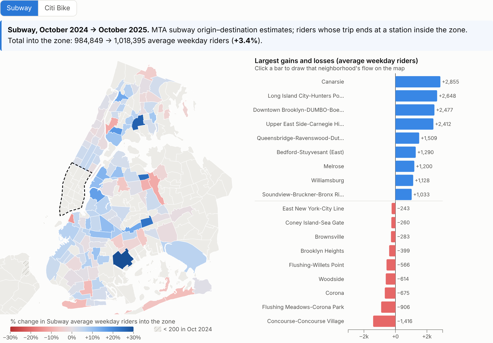

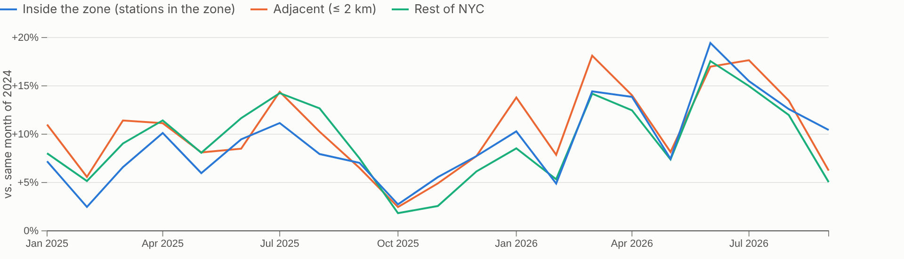

*Data: MTA Subway Origin-Destination Ridership Estimates (Oct 2024, Oct 2025; `q6_subway_od_into_crz_by_neighborhood.csv`) and Citi Bike trip data (Oct 2024, Oct 2025; `q6_citibike_origins.csv`).*

*Data: MTA Subway Hourly Ridership (`q6_subway_by_area.csv`). Entries count where riders start, not where they go.*

**D3 code:** [`milestone3/js/q6.js`](js/q6.js) (uses helpers in [`js/common.js`](js/common.js))

**What the visualization shows**

The map colors each origin neighborhood by the change in trips **into the zone** between October 2024 and October 2025 (blue = more, red = fewer; hatched = too few trips to color reliably). The buttons switch between the subway and Citi Bike, the bar chart lists the biggest gains and losses, and clicking a neighborhood or bar draws its flow line into the zone.

**Subway:** estimated weekday subway riders traveling into the zone rose from about 985,000 to 1,018,000 (**+3.4%**). The largest gains came from Canarsie (+2,900 a day), Long Island City–Hunters Point (+2,600), Downtown Brooklyn and the Upper East Side (about +2,400 each); the largest losses were from the Bronx and Queens (Concourse −1,400, Flushing Meadows–Corona −900). Neighborhoods inside the zone are destinations here, so they are left grey. The line chart below shows that subway entries grew everywhere in 2025 (+7–8% vs. 2024 in every area) and by about +12% in 2026, so subway growth is citywide, not specific to the zone.

**Citi Bike:** trips ending in the zone fell from 2.46 M to 2.28 M (**−7%**), and trips coming from outside the zone fell more (−11%). Only 15 of the 106 origin neighborhoods outside the zone grew, and those gains are tiny (at most about +130 trips a month). The biggest losses are from the neighborhoods right next to the zone: Central Park (−9,300 trips), the Upper West Side and the Upper East Side. We did not find evidence of a shift toward cycling into the zone; month-specific factors such as weather and pricing may matter more than the toll.

## Q7. Have crashes and injuries inside the zone gone down compared with the rest of the city?

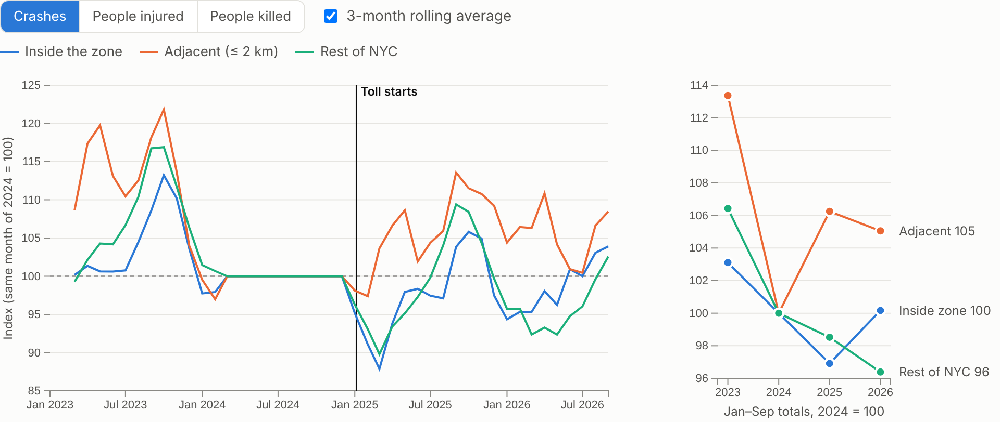

*Data: NYPD Motor Vehicle Collisions, monthly by area, Jan 2023 – Sep 2026 (`q7_monthly_by_area.csv`). Left: each month divided by the same month of 2024. Right: Jan–Sep totals, 2024 = 100.*

**D3 code:** [`milestone3/js/q7.js`](js/q7.js) (uses helpers in [`js/common.js`](js/common.js))

**What the visualization shows**

Both charts put the three areas on a common scale by dividing by 2024, so a line below 100 means fewer crashes than in 2024. The buttons switch between crashes, people injured and people killed, and the checkbox turns a 3-month rolling window on or off (deaths are small numbers and very noisy month to month).

Inside the zone, crashes in Jan–Sep 2025 were **3% lower** than in 2024 (5,212 vs. 5,378) and injuries 3% lower. The rest of the city fell by a similar 1.5%, so the zone did only slightly better. In 2026 the zone returned to its 2024 level (5,387 crashes, and injuries 5% *above* 2024) while the rest of the city kept falling (−4%). The adjacent ring was higher than 2024 in both years (+6% in 2025). Overall, these data do not show a lasting safety gain inside the zone relative to the rest of NYC.

## Q8. Putting everything together, which areas gained the most and which carried the costs?

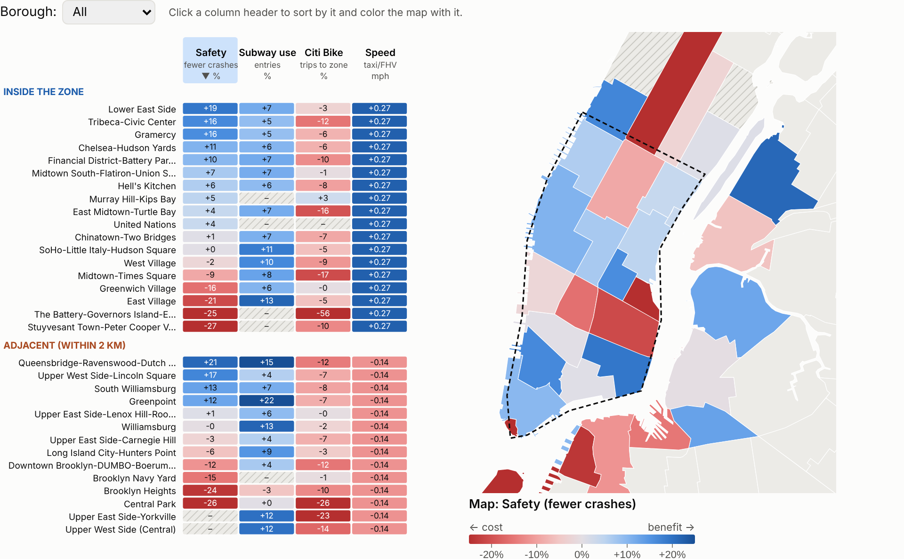

*Data: `q8_nta_summary.csv`, joined from the Q4–Q7 outputs. Every column is signed so that positive = benefit (for safety, a 10% drop in crashes is +10). Each column has its own color scale; hatched = no data.*

**D3 code:** [`milestone3/js/q8.js`](js/q8.js) (uses helpers in [`js/common.js`](js/common.js))

**What the visualization shows**

The matrix has one row per neighborhood inside the zone or within 2 km of it and one column per outcome. Blue cells are improvements, red cells are costs. Clicking a column header sorts the rows by that outcome and colors the map with it; the borough filter limits both views.

The clearest pattern is by column rather than by place: **subway use** went up almost everywhere (+4% to +22%), **Citi Bike trips into the zone** went down almost everywhere, and **speed** improved inside the zone (+0.27 mph) but not in the adjacent ring (−0.14 mph). **Safety** is the column that separates neighborhoods.

- **Gained the most:** Lower East Side, Tribeca–Civic Center, Gramercy and Chelsea–Hudson Yards inside the zone (11–19% fewer crashes plus more subway use and faster taxis), and Queensbridge–Ravenswood, Greenpoint, South Williamsburg and Upper West Side–Lincoln Square outside it (12–21% fewer crashes and 4–22% more subway entries).
- **Carried costs:** Central Park, Brooklyn Heights, the Brooklyn Navy Yard and Downtown Brooklyn–DUMBO, all in the adjacent ring, had 12–26% more crashes, fewer Citi Bike trips into the zone and slightly slower taxis. Inside the zone, Stuyvesant Town, East Village and Greenwich Village also had more crashes (16–27%) even though traffic there got faster.

Several of these neighborhoods have only a few hundred crashes a year, so a 20% swing can be a few dozen crashes; the hover tooltip shows the underlying change for each cell.

## Data gaps and limitations

- **Correlation, not causation.** Return-to-office trends, weather, construction and fare changes all coincide with 2025.
- **No pre-toll baseline** in the CRZ entry or excluded-roadway counts; before/after views rely on tunnel crossings (Q2) and speeds (Q4).
- **Speeds** come from taxi/FHV trips, end in August 2025 in our download, and have no peak/off-peak split.
- **Zone outline** on the maps is hand-digitized (about 100 m accuracy) and entry-point locations are approximate.
- **Crashes** without coordinates (about 6%) are dropped; deaths are small counts and noisy.
- **Citi Bike** and subway origin–destination comparisons use a single month (October) in each year.

**Next steps for the final:** load the official MTA geofence, add a short guided narrative between sections, refine colors and labels after user feedback, and add a table view for each chart.

## AI use statement

<div class="ai">

Per the course AI policy, we’re documenting how our team used Claude Opus 5.5 (Anthropic) through the Claude app in Milestone 3. This statement also appears in the repository README.

- **Project design and data preparation.** Our team chose the research questions and datasets, defined the processing rules, and built the data pipelines in Milestones 1 and 2. We used our hand-drawn Milestone 2 sketches to specify the chart type, visual encodings, and interactions for each question.
- **Implementation and testing.** Claude wrote the first drafts of all eight D3 charts in `milestone3/js/`, the shared helpers in `common.js`, the page layout and CSS, and `scripts/m3_build_geo.py`, which converts the 2020 NTA boundaries to GeoJSON. We ran the page, checked tooltip values against the CSVs, and asked Claude to revise charts when we found errors or unclear behavior.
- **Analysis and writing.** Our team decided how to interpret the results, including describing the relationships we observed as associations. Claude drafted the introduction and the “What the visualization shows” paragraphs using summary numbers computed from our processed tables. We verified every number and edited the wording to reflect our interpretation.

</div>
